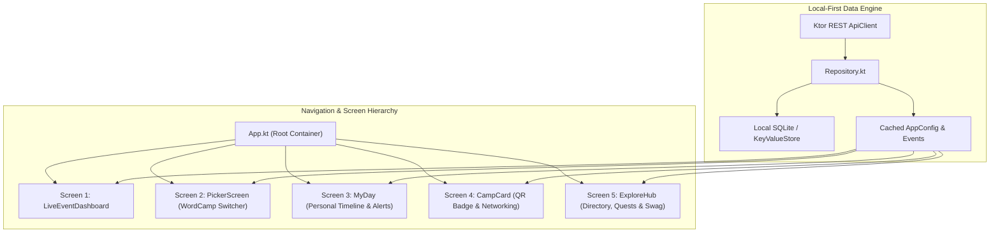

# CampBuddy APK UI Evolution: Tactile Card-First System

* **Author:** rjcodextech
* **Status:** Draft
* **Date:** 2026-11-24

--------------------------------------------------------------------------------

## Overview

This technical design document outlines the comprehensive restructuring of the CampBuddy mobile application (Android APK / iOS KMP) from a multi-tab, text-dense layout into a 5-screen tactile, card-first architecture. Inspired by the physical ergonomics and cognitive clarity of "Aura Saathi", this design reorganizes all 16 existing attendee and organizer capabilities into five focused screens while strictly adhering to CampBuddy's official brand design system: Baloo 2 display typography, Poppins UI copy, Navy `#1E293B`, Coral `#FF4D2D`, Ochre `#D97706`, and Paper Soft `#FFF7ED`.

This redesign requires **zero backend schema migrations** and **zero new API endpoints**, operating entirely within existing Ktor network fetchers and local-first SQLite / KeyValueStore offline caches.

--------------------------------------------------------------------------------

## The Problem

WordCamp conferences are dynamic, high-density, physical events where hundreds of attendees navigate crowded corridors, simultaneous track sessions, and bustling sponsor halls. Observational analysis reveals severe attendee drop-off in the current APK:

1. **Hallway Cognitive Overload:** The current 7-tab interface presents schedules as multi-column, multi-track grids that require pinch-to-zoom, horizontal scrolling, and complex filtering. Attendees walking between halls have at most 2–3 seconds to answer *"Where do I go right now?"* and abandon the app for printed schedules or WhatsApp when faced with nested menus.
2. **Obscured Immediate Value:** Core high-frequency actions—such as exchanging a CampCard QR badge, discovering other attendees by WordPress interests, or finding sponsor booth swag—are buried across deep secondary views.
3. **Connectivity Fragility:** Venue Wi-Fi routinely stutters during keynotes and lunch breaks. When the app fails to display cached schedules immediately or lacks visible offline reassurance, attendees assume it is broken and close it.

The proposed solution eliminates this friction by transforming the home screen into an ambient "Air-Traffic Controller" displaying the current event phase, next session countdown, 4 pinned contacts, 6 oversized tactile action cards, and a persistent emergency helpdesk anchor.

--------------------------------------------------------------------------------

## Goals

* **G-1 (Rapid Corridor Glanceability):** Deliver the exact next session, track hall name, and minute countdown on the primary viewport within 2 seconds of cold start.
* **G-2 (100% Feature Parity):** Map all 16 existing features (Guide, Schedule, Reminders, Attendee Discovery, Sponsors/Swag, Legal/GDPR, Admin Staff Hub, Contributor Guide, Quests, Directory by Roles, CampCard QR, Offline Cache, Event Switcher, Desktop Migration, Claim Profile) without dropping any functionality.
* **G-3 (Physical Ergonomics & Accessibility):** Enforce minimum 48dp x 48dp touch targets across all top-bar utilities, single-line text clamping in 2x3 grid tiles to support up to 130% system font scaling, and WCAG AA (>4.5:1) contrast ratios on all text elements.
* **G-4 (Zero Backend & Offline Parity):** Require 0 new API endpoints or database migrations. Ensure 100% of event data remains navigable offline via `Repository.warmUp()` with an ambient status indicator.

--------------------------------------------------------------------------------

## Non-Goals

* **NG-1 (No Standalone Language Picker):** Removing the mandatory cold-start language selection screen. System locale detection (`en` / `hi`) will determine default text, with manual switching relegated to settings.
* **NG-2 (No Backend Schema Mutations):** No changes to Laravel database tables, migrations, or REST API response structures.
* **NG-3 (No OS-Level Launcher Interception):** No Android `CATEGORY_HOME` intent filters, system device admin bindings, or external application tracking.

--------------------------------------------------------------------------------

## Open Questions

* **Question 1 (Staff Hub Role Boundary):** Should the `👑 Staff` console trigger in the top bar be conditionally visible strictly when `env.repository.organizerRole()` is non-null, or present for all attendees with a PIN/login modal on tap? (Current assumption: Render staff badge only when the device has paired organizer credentials, otherwise keep clean).
* **Question 2 (Event Switcher Offline Scope):** When an attendee is completely offline, should the Event Switcher (Screen 2) hide un-cached WordCamps entirely, or display them with a disabled "Offline: Open when connected" badge? (Current assumption: Display all events, but mark un-cached events as requiring connectivity).

--------------------------------------------------------------------------------

## Critical User Journeys (CUJs)

### CUJ 1: Corridor Hallway Next-Session Check
* **Given**: An attendee is walking through a noisy conference hallway between sessions with weak or absent venue Wi-Fi.
* **When**: The attendee opens the CampBuddy APK from the home screen.
* **Then**: The app launches immediately into Screen 1 (`LiveEventDashboard`). The Hero Card prominently displays the time (`10:30`), the green `● Offline Ready` indicator, and the "Next Up: Keynote Hall A (Track 1) • Starts in 15 mins" pill with a high-contrast Gold "View" button. Total time to decision is under 2 seconds.

### CUJ 2: Hallway Networking & CampCard QR Exchange
* **Given**: An attendee meets a peer at a sponsor table and wants to exchange contact information without typing.
* **When**: The attendee taps the "My CampCard" tile (Grid Tile 3) on Screen 1.
* **Then**: Screen 4 opens instantly, displaying their high-contrast, offline-rendered QR badge (`QRCode.ofSquares()`) along with active social tags (LinkedIn, WordPress.org, Twitter). The peer scans the QR code using their camera or CampBuddy's built-in scanner.

### CUJ 3: Schedule Management & Conflict Detection
* **Given**: An attendee has bookmarked multiple simultaneous talks across Track 1 and Track 2.
* **When**: The attendee taps "My Day" (Grid Tile 1) on Screen 1.
* **Then**: Screen 3 renders a personalized timeline. If two talks overlap, a prominent warning chip flags the conflict, allowing the attendee to resolve it with a single tap of the "Remove" or "Switch" action.


--------------------------------------------------------------------------------

## Technical Plan (Architecture)

### Architectural Overview

The redesigned application adopts a reactive, declarative unidirectional data flow (UDF) powered by **Compose Multiplatform (KMP)** and **Kotlin Coroutines**. The 7-tab bar in `EventScreens.kt` is replaced with a 5-screen hierarchy anchored by an air-traffic controller dashboard (`LiveEventDashboard`).



### Component Hierarchy & Structural Decomposition

```text
App (App.kt)
 ├── CampBuddyTheme (Theme.kt - Baloo 2 + Poppins, Navy, Coral, Ochre)
 └── CompositionLocalProvider (LocalWords, LocalBrand, LocalEnv)
      │
      ├── Screen 1: LiveEventDashboard (EventScreens.kt)
      │    ├── TopBar (Wordmark, 👑 Staff Pill [48dp], ❓ Guide [48dp], 🔄 Switcher [48dp])
      │    ├── EventHeroCard (Navy #1E293B, Baloo 2 Clock, Next-Up Pill, WCAG AA Contrast)
      │    ├── PeopleStrip (Horizontal LazyRow, Pinned Contacts, Interest Wave Trigger)
      │    ├── ActionGrid (2x3 Tactile Hubs with single-line clamped metadata)
      │    │    ├── Tile 1: My Day (Navigate -> Screen 3)
      │    │    ├── Tile 2: Schedule (Navigate -> Full Tracks Modal)
      │    │    ├── Tile 3: My CampCard (Navigate -> Screen 4)
      │    │    ├── Tile 4: Attendees (Navigate -> Screen 5)
      │    │    ├── Tile 5: Quests (Navigate -> Screen 5)
      │    │    └── Tile 6: Sponsors & Swag (Navigate -> Screen 5)
      │    ├── LegalFooter (Scrollable body: Privacy, Terms, GDPR Erasure)
      │    └── StickyHelpBar (Persistent bottom container: Coral #FF4D2D SOS Helpdesk)
      │
      ├── Screen 2: PickerScreen (PickerScreen.kt)
      │    ├── CountryFilterRow (All, India, Japan, Europe, USA filter pills)
      │    ├── DesktopSyncCard (6-digit code bookmark import)
      │    └── WordCampEventList (Offline-cached badge indicator, active switcher)
      │
      ├── Screen 3: MyDayTab (MyDay.kt)
      │    ├── ScheduleHealthBanner (Saved count, hours planned, conflict detection)
      │    ├── ConflictWarningCard (Identifies overlapping sessions)
      │    ├── NotificationToggleRow (10-minute prior local alerts)
      │    └── TimelineList (LazyColumn of saved sessions with instant removal)
      │
      ├── Screen 4: CampCardTab (CampCardScreen.kt)
      │    ├── ClaimProfileBanner (Verified attendee status indicator)
      │    ├── QRCodeDisplay (QRCode.ofSquares() offline rendering)
      │    ├── SocialHandleBadges (LinkedIn, WordPress.org, Twitter, Website)
      │    └── InterestDiscoveryCard (Gutenberg, REST, Core match waves)
      │
      └── Screen 5: ExploreHubTab (MoreTabs.kt + People.kt)
           ├── RoleFilterCarousel (All, Speakers, Organizers, Sponsors, Volunteers, Media)
           ├── ContributorRoadmapCard (Step-by-step Contributor Day ramp)
           ├── QuestsChecklist (Gamified badge milestones)
           ├── SponsorDealsList (Steals, deals, booth swag)
           └── LegalDataSheetModal (GDPR export and deletion requests)
```

### State Management & Lifecycle Mechanics

1. **Clock & Phase Synchronization:**
   - The primary Hero Card is driven by `rememberNow()` emitting every 30 seconds (`delay(30_000)`).
   - `EventClock.phase(sessions, firstDay, lastDay, zone, now)` computes the active phase: `Phase.Before`, `Phase.During`, or `Phase.After`.
   - The "Next Up" session is derived via `EventClock.nextSession(sessions, now, zone)`, displaying the remaining minutes without querying the network.

2. **Offline Warm-Up Engine:**
   - On event selection, `Repository.warmUp(slug)` fetches and writes the full session manifest, speaker directory, sponsor deals, and quests to SQLite / `KeyValueStore`.
   - When offline, `LoadState.Ready` surfaces data immediately with `fromCache = true`, triggering the green breathing pulse indicator (`● Offline Ready`).

3. **Predictable Back-Stack Navigation:**
   - `PlatformBackHandler` controls transitions. Navigating from Screen 1 into secondary screens (Screens 2–5) preserves state and pops back cleanly to `LiveEventDashboard` on system back press.

### Brand Design Tokens & UI Constraints

| Token Group | Value / Spec | Architectural Implementation |
| :--- | :--- | :--- |
| **Grounds** | `#FFF7ED` (Paper Soft), `#FAFAFD` (Cards) | Screen background and elevated card surfaces |
| **Primary Voices** | `#0F172A` (Ink), `#1E293B` (Navy) | Hero Card container and high-contrast titles |
| **Accents** | `#FF4D2D` (Coral), `#D97706` (Ochre) | Emergency SOS button, "View" CTA, and active pills |
| **Radii Tokens** | Cards: `20.dp`, Pills: `50%`, Rows: `14.dp`, Chips: `6.dp` | Enforced through `Theme.kt` (`Radii`) |
| **Touch Bounds** | Minimum `48.dp x 48.dp` | Top-bar icons wrapped in 48dp clickable containers |
| **Text Clamping** | `TextOverflow.Ellipsis`, `maxLines = 1` | Secondary metadata in 2x3 grid to support 130% font scale |


--------------------------------------------------------------------------------

## Alternatives Considered

### Alternative A: Retaining Current 7-Tab Bottom Navigation Bar

* **Pros**: Maintains visual continuity with legacy versions of the PWA and native app; provides dedicated bottom-docked access points for all primary tabs.
* **Cons**: Introduces severe cognitive clutter on narrow mobile screens (320–360dp width); forces dense multi-column schedule browsing in noisy conference corridors; causes high attendee drop-off during active event hours.
* **Reason for Rejection**: `Rejected by author: Attendees walking through physical venue corridors have at most 2–3 seconds to make a navigation decision. The multi-tab bottom bar creates decision paralysis and forces deep menu navigation, causing attendees to abandon the app in favor of printed schedules or chat channels.`

### Alternative B: Floating Action Button (FAB) Speed Dial Overlay

* **Pros**: Preserves an uncluttered central viewport by collapsing actions into a single floating circular icon in the bottom right corner.
* **Cons**: Obscures critical capabilities (My Day, Schedule, CampCard Badge) behind an extra exploratory tap; conflicts with the persistent emergency SOS Helpdesk dock; creates thumb reachability friction for one-handed operation.
* **Reason for Rejection**: `Rejected by author: Floating action menus hide critical conference destinations behind exploratory clicks and obstruct the persistent emergency SOS Helpdesk anchor.`

### Alternative C: Standalone Cold-Start Language Selection Screen

* **Pros**: Forces explicit language selection upon first launch for multilingual regional WordCamps.
* **Cons**: Adds mandatory onboarding friction before an attendee can see their event schedule; delays time-to-value on first cold start.
* **Reason for Rejection**: `Rejected by author: Forcing a language selection gate before showing the schedule increases first-launch abandonment. The app can detect system locale (English/Hindi) automatically and allow regional language switching inside settings without gating the primary dashboard.`


--------------------------------------------------------------------------------

## Non-Functional Requirements

### Security & Privacy
* **Local-First Privacy:** All CampCard contact exchanges operate peer-to-peer via optical QR scanning (`QRCode.ofSquares()`) with zero external server tracking or telemetry.
* **Granular Consent:** Attendee interest matching is strictly opt-in. Attendee profile data can be wiped at any time through the GDPR Data Erasure modal.
* **Encrypted Storage:** Auth tokens and bookmarks are secured on Android via `EncryptedSharedPreferences` (`campbuddy_secure`).

### Performance & Latency
* **Cold-Start Decision Speed:** The primary viewport and Next-Up talk render in < 100ms from local SQLite cache upon cold start.
* **Low-Power Telemetry:** Event clock countdowns update every 30 seconds (`delay(30_000)`), avoiding CPU wake-locks or battery drain.
* **Recomposition Efficiency:** All LazyColumn items are keyed (`key = { it.slug }`, `key = { it.id }`) to eliminate frame drops on low-tier Android hardware.

### Rollout & Backward Compatibility
* **Zero Schema Invalidation:** Operates entirely within the current Laravel REST API endpoints (`sessions`, `event`, `roster`, `quests`, `deals`, `legal`). No database migrations or API version bumps required.

--------------------------------------------------------------------------------

## Detailed Implementation Plan

### Target Files to Create/Modify

#### 1. `native-app/shared/src/commonMain/kotlin/club/campbuddy/shared/ui/EventScreens.kt` (Modify)
* **Scope**: UI Layout & Navigation Hub.
* **Rationale**: Replace the current 7-tab bottom bar with the new `LiveEventDashboard` root composable.
  * Implement `TopBar` with explicit `48.dp x 48.dp` clickable touch target bounds for `👑 Staff`, `❓ Guide`, and `🔄 Switcher`.
  * Build `EventHeroCard` with Navy `#1E293B` gradient, Baloo 2 clock, and high-contrast WCAG AA (>4.5:1) session countdown sub-pill.
  * Integrate `PeopleStrip` displaying pinned contacts with interest match dots.
  * Construct `ActionGrid` (2x3 tactile cards) with `TextOverflow.Ellipsis` and `maxLines = 1` clamping for secondary metadata.
  * Embed `LegalFooter` in the scrollable content container and anchor the persistent emergency `StickyHelpBar` (Coral `#FF4D2D` SOS) above window insets.
  * Bind `PlatformBackHandler` for predictable pop-to-root back-stack navigation.

#### 2. `native-app/shared/src/commonMain/kotlin/club/campbuddy/shared/ui/PickerScreen.kt` (Modify)
* **Scope**: Event Selection & Sync View.
* **Rationale**: Adapt the WordCamp switcher to support horizontal country filter chips (`All`, `India`, `Japan`, `Europe`, `USA`) and embed the 6-digit desktop-to-mobile sync code import card. Render explicit `● Offline Ready` badges on previously cached WordCamps.

#### 3. `native-app/shared/src/commonMain/kotlin/club/campbuddy/shared/ui/MyDay.kt` (Modify)
* **Scope**: Personal Schedule & Conflict Resolver.
* **Rationale**: Integrate the `ScheduleHealthBanner` showing total bookmarked talks and hours planned. Add conflict detection logic to warn users of overlapping track sessions. Add 10-minute prior local alert toggles and 1-tap session removal actions.

#### 4. `native-app/shared/src/commonMain/kotlin/club/campbuddy/shared/ui/CampCardScreen.kt` (Modify)
* **Scope**: QR Badge & Networking Hub.
* **Rationale**: Integrate the verified attendee profile claim banner (`ClaimProfile`), high-contrast optical QR code rendering via `libs.qrcode`, active social handle tags (LinkedIn, WordPress.org, Twitter, Website), and the WordPress interest match wave card.

#### 5. `native-app/shared/src/commonMain/kotlin/club/campbuddy/shared/ui/MoreTabs.kt` (Modify)
* **Scope**: Directory, Quests & Opportunities Hub.
* **Rationale**: Consolidate disparate tabs into `ExploreHubTab`:
  * Horizontal role filter carousel (`All`, `Speakers`, `Organizers`, `Sponsors`, `Volunteers`, `Media`).
  * Contributor Day step-by-step onboarding roadmap.
  * Quests and gamification badge checklist.
  * Sponsor steals, deals, and booth swag directory.
  * GDPR data export and deletion trigger.

#### 6. `native-app/shared/src/commonMain/kotlin/club/campbuddy/shared/ui/Theme.kt` (Modify)
* **Scope**: Design Tokens & Typography.
* **Rationale**: Enforce `Radii.card` (20dp), `Radii.pill` (50%), `Radii.row` (14dp), and `Radii.chip` (6dp) across all new composables. Declare high-contrast color tokens for the Navy `#1E293B` ground and Ochre `#D97706` / Coral `#FF4D2D` action accents.

#### 7. `native-app/shared/src/commonMain/kotlin/club/campbuddy/shared/ui/LegalSheet.kt` (Modify)
* **Scope**: Legal & Privacy Modal Sheet.
* **Rationale**: Ensure privacy policy, terms of use, and GDPR data erasure requests are directly actionable when opened from either Screen 1 footer or Screen 5.

#### 8. `native-app/shared/src/commonMain/kotlin/club/campbuddy/shared/App.kt` (Modify)
* **Scope**: Root Navigation Graph.
* **Rationale**: Wire screen transitions across the 5 primary views (`LiveEventDashboard`, `PickerScreen`, `MyDay`, `CampCard`, `ExploreHub`), ensuring back-stack state is preserved upon navigation.

#### 9. `native-app/shared/src/commonTest/kotlin/club/campbuddy/shared/EventScreensTest.kt` (Create/Modify)
* **Scope**: Unit & UI Tests.
* **Rationale**: Implement automated tests verifying:
  * `LiveEventDashboard` correctly renders the "Next Up" session countdown.
  * All 16 features are reachable via direct or 1-tap navigation paths.
  * Card metadata clamps without text clipping under 130% accessibility font scaling.

--------------------------------------------------------------------------------

### Additional Resources
* **Concepts Brief**: [concepts_brief.md](./concepts_brief.md)
* **Wireframe Specification**: `C:/Users/sunil/.gemini/antigravity/brain/bd655e0a-5a1d-4d84-917e-eca77c7a4030/wireframe.md`
* **Interactive HTML Preview**: `C:/Users/sunil/.gemini/antigravity/brain/bd655e0a-5a1d-4d84-917e-eca77c7a4030/wireframe.html`
* **Brand Tokens Source**: `app/Support/BrandTokens.php`
