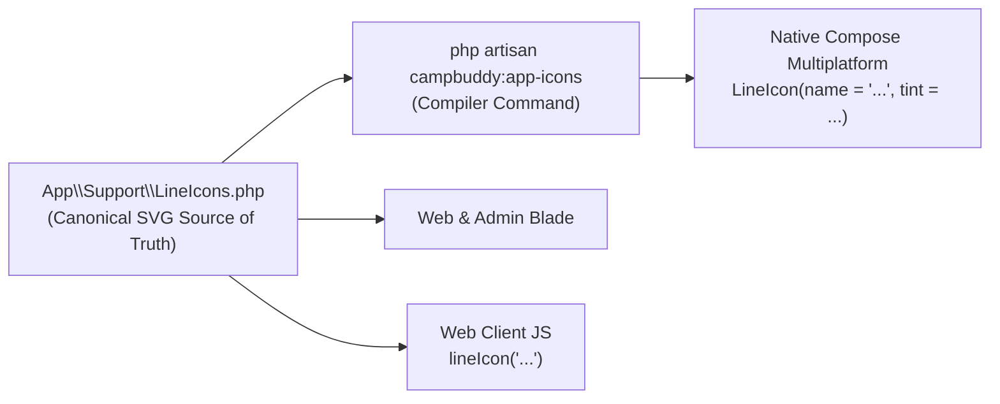

# CampBuddy Unified Icon Design System

* **Author:** rjcodextech
* **Date:** 2026-11-24
* **Standard:** 24×24 viewBox, 1.8px round stroke, Lucide/Feather geometric harmony
* **Target Platforms:** Web (Blade/JS), Organizer Admin Panel, Compose Multiplatform (Android APK / iOS KMP)

--------------------------------------------------------------------------------

## Architectural Pipeline: "Design Once, Render Everywhere"



---

## Newly Designed & Integrated Icons Catalog

| Icon Name | Category | Primary Usage Surface | Geometric Spec & Key Landmarks |
| :--- | :--- | :--- | :--- |
| `qr-code` | App Hub / Badge | APK Screen 4, Web Badge, Admin Check-in | 3 anchor finder squares at corners (`3x3`, `14x3`, `3x14`) with internal sync timing tracks. |
| `crown` | Admin / Staff | APK TopBar `👑 Staff`, Admin Console | 5-point crown with reinforced baseline for high-contrast touch boundaries. |
| `gift` | Sponsors & Swag | APK Grid Tile 6, Web Swag directory | Tied ribbon package with dual-loop bow, 4px ribbon collar, and 12px drop box. |
| `target` | Quests & Prep | APK Grid Tile 5, Web Quests | Triple concentric target circles (`r=10`, `r=6`, `r=2`) with center bullseye. |
| `award` | Badges / Contributor | APK Screen 5, Quest unlocks | Octagonal rosette medal with dual ribbon tails extending at 45-degree angles. |
| `shield-check` | Trust & Privacy | APK Screen 4, Web Privacy Policy | Medieval heater shield contour with verified checkmark inset. |
| `shield-alert` | CoC & Safety | APK Sticky SOS Bar, Incident Report | Shield outline with centered exclamation mark and 2px separation dot. |
| `life-buoy` | Emergency Helpdesk | APK Sticky Bottom Anchor, Help Desk | Dual concentric rings with 4 diagonal radial ropes at 45-degree tangents. |
| `presentation` | Schedule & Talks | APK Grid Tile 2, Web Schedule | Speaker projector screen with tripod legs and top hanger rod. |
| `user-check` | Profile / Claiming | APK Screen 4, Attendee Directory | Silhouette head and shoulders with active checkmark on right flank. |
| `user-plus` | Discovery & Wave | APK Screen 1 My People, Networking | Silhouette head and shoulders with 4-quadrant addition plus cross. |
| `scan` | Optical Viewfinder | APK Camera Badge Scanner, Admin Check-in | 4 corner reticles (`L`-brackets) framing a central optical alignment zone. |
| `file-text` | Legal & GDPR | APK Legal Footer, Terms & Privacy | Folded-corner document outline with 3 horizontal paragraph text rules. |
| `layout-dashboard`| Admin & Operations | Web Portal, Organizer Console | Quad-bento dashboard tiles in asymmetrical grid. |

---

## Consumption Across Frameworks

### 1. In Compose Multiplatform (`native-app/shared`)
```kotlin
// Automatically available via LineIcon composable
LineIcon(
    name = "qr-code",
    tint = LocalBrand.current.primary,
    size = 24.dp
)
```

### 2. In Laravel Blade (`resources/views`)
```blade
{{-- Web frontend and Admin panel --}}
<x-attendee.line-icon name="crown" class="w-5 h-5 text-coral" />
```

### 3. In Client-Side JavaScript
```javascript
// Clones from the inlined SVG sprite
const iconNode = lineIcon('target');
document.getElementById('quest-container').appendChild(iconNode);
```

---

## Interactive Specimen Link
Preview the interactive icon specimen with dynamic sizing (18px, 24px, 36px) and color contrast validation:
- [icon_design_specimen.html](file:///C:/Users/sunil/.gemini/antigravity/brain/bd655e0a-5a1d-4d84-917e-eca77c7a4030/icon_design_specimen.html)
