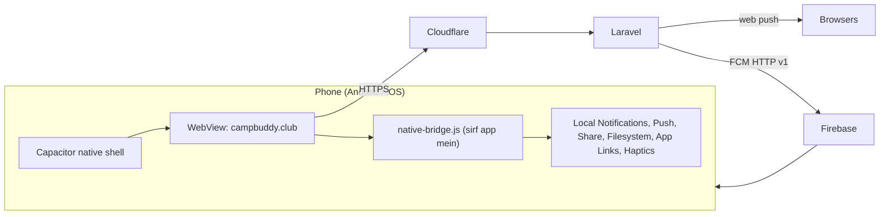

# Architecture

App pehchaan: UA suffix `CampBuddyApp/1.0 (ios|android)` + `window.Capacitor`.

| Web feature | App ke andar |
|---|---|
| Install popup, iOS install instruction, My Day iPhone card | chhupa do |
| Desktop notice | lagu nahi |
| Session reminder (Web Push) | **Local notification** |
| Thank-you / Memories / day 7 / day 15 / upcoming push | **FCM** |
| Camp Card PNG / PDF | Filesystem save + Share sheet |
| Bahar ke links | system browser |
| GA `platform` | `app_ios` / `app_android` |

App JS ek `native-bridge.js` mein; existing modules mein sirf chhote hooks (do popup).
